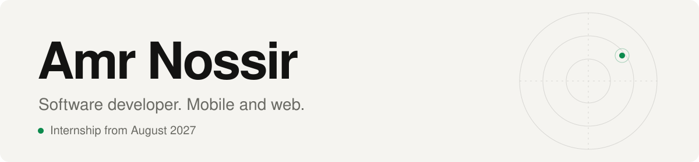

<picture>
  <source media="(prefers-color-scheme: dark)" srcset="assets/banner-dark.svg">
  
</picture>

I'm a software engineering student at **Multimedia University** in Malaysia, graduating in December 2027. I build mobile and web apps, and I'm looking for an **internship starting in August 2027**.

[Portfolio](https://amrnossir.netlify.app) · [Resume](https://amrnossir.netlify.app/resume/) · [LinkedIn](https://www.linkedin.com/in/amr-nossir/)

## Projects

| | |
|---|---|
|  | **[Atoll ATC](https://github.com/Ghostgmyt/atoll-atc)** A live, multiplayer air traffic control simulator for the Maldives. JavaScript and canvas, no framework. [Play it](https://ghostgmyt.github.io/atoll-atc/) |
|  | **Lumen News** A news reader that reads the day's stories aloud, with a local language model. Flutter, Dart and Python. Final-year project, in progress. |
|  | **[TT4L-12](https://github.com/Ghostgmyt/TT4L-12)** The 2024 Flask air traffic control app that Atoll grew out of. |

## Skills

**Mobile** Flutter · Dart · Riverpod · SQLite  
**Web** HTML · CSS · JavaScript · Flask · Socket.IO  
**Programming** Python · C++ · SQL · Git
